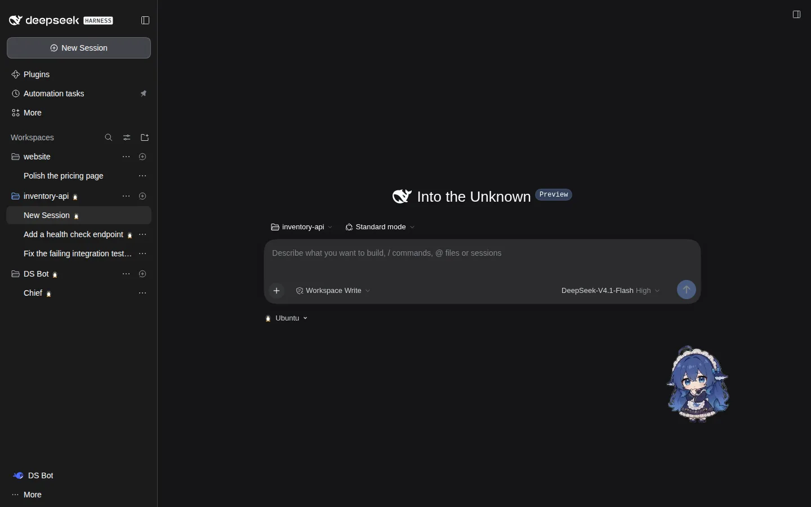
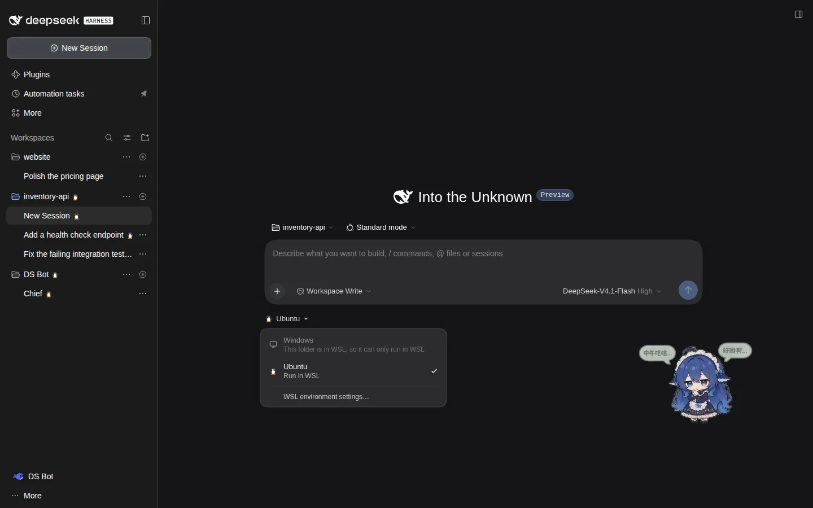
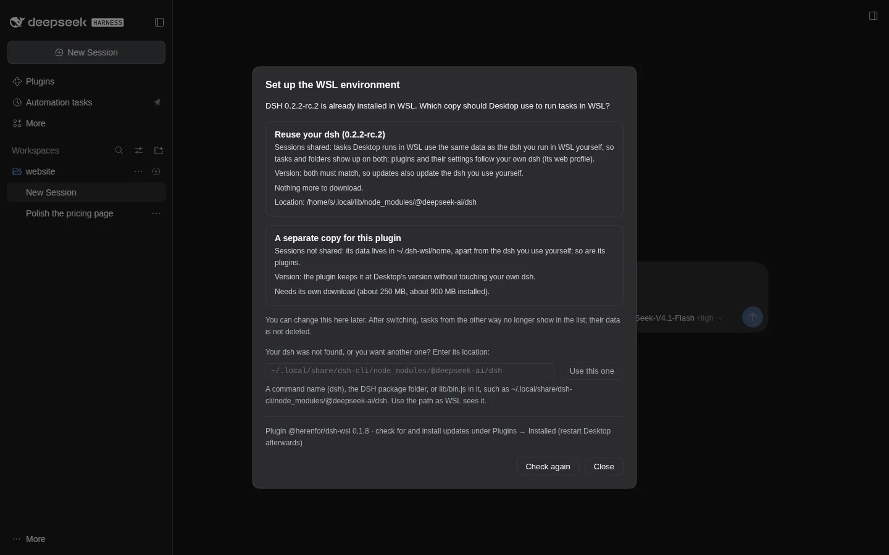
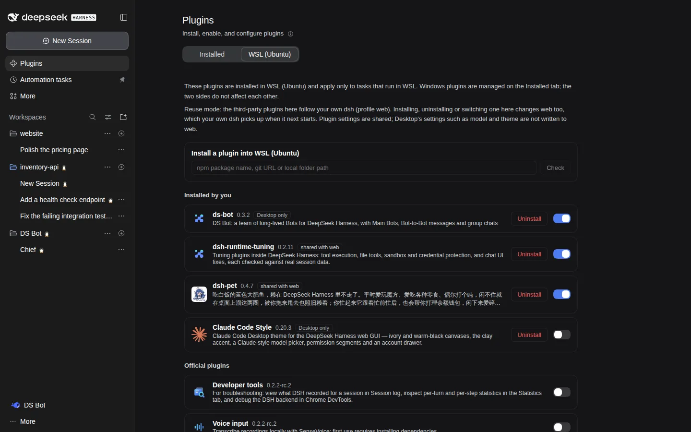
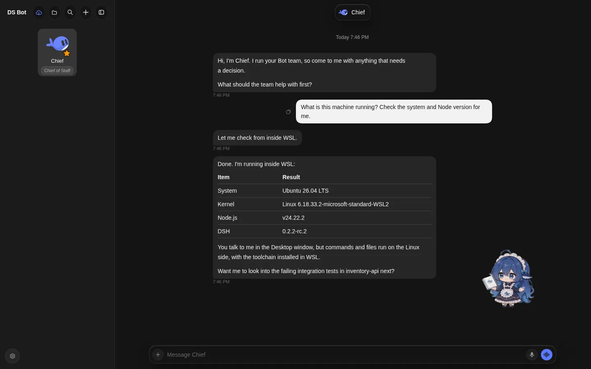

<div align="center">


# dsh-wsl

**Run DeepSeek Harness tasks in WSL from the Windows Desktop window**

[](https://www.npmjs.com/package/@herenfor/dsh-wsl)   [](LICENSE)

English · [中文](README.zh.md)

</div>



<sub>Screenshots from a test environment, for illustration only. The third-party plugins shown are listed under "Screenshot credits" at the end.</sub>

## Highlights

- **Run location per folder**: switch between Windows and WSL under the input box; folders inside WSL run in WSL by themselves.
- **One window for both sides**: the sidebar, scheduled tasks and the choices in Settings list Windows and WSL together.
- **Linux plugins just work**: plugins installed in WSL, including ones that change the interface, work in the Desktop window, and have their own WSL tab on the Plugins page.
- **Credentials stay out of WSL**: WSL tasks get model credentials from Desktop; nothing is written to the WSL disk.
- **No official code changed**: built only from plugins and external components, starting and stopping with Desktop.

## Screenshots

<table>
<tr>
<td width="50%"><br><sub>Pick the run location under the input box</sub></td>
<td width="50%"><br><sub>First-run setup: reuse your own dsh or use a copy of its own</sub></td>
</tr>
<tr>
<td width="50%"><br><sub>The WSL tab on the Plugins page</sub></td>
<td width="50%"><br><sub>DS Bot installed in WSL, with its own interface working in the Desktop window</sub></td>
</tr>
</table>

## Quick start

**Install `@herenfor/dsh-wsl` in Windows Desktop only. It deploys the WSL companion, `dsh-wsl-agent`, automatically; do not install a second bridge inside WSL.**

1. Desktop → Plugins → Add plugin → Install a third-party plugin, enter `@herenfor/dsh-wsl` and install.
2. Quit Desktop completely (in the system tray too), wait at least 5 seconds, then open it again.
3. On the new-task page, switch the run location under the input box to WSL and follow the "Set up the WSL environment" window.

Reuse mode detects DSH on PATH and in common standalone install folders, so an entry usually needs no input. Manual entries are under “Advanced”. Saved pnpm version paths are repaired when the corresponding stable package entry is valid; check again after upgrading to pick up the new version.

**rc.3 live verification (2026-11-14):** Windows Desktop and WSL both ran DSH `0.2.2-rc.3`. The `0.1.12-dev.1` candidate verified automatic discovery, persistent migration of old pnpm entries, rc.3 Host / daemon startup, and connection and task mirroring after the first restart. UI behavior was checked through code and state; migration logs were not observed directly. This acceptance did not cover every plugin combination or a second restart.

**0.1.13 local checks (2026-11-14):** the real DSH `0.2.2-rc.3` manager and two isolated Hosts cover wrong-location rejection, removal recovery, retained sessions and reconnection after reinstall; the Chinese notice was checked in a browser screenshot. Desktop is simulated with a private Linux copy, not a native Electron window. The latest use-side record is plugin `0.1.12`, with Desktop / WSL on rc.3: bridge and tuning loaded after restart; `web` was stopped, so creating a session there was not checked online.

Needs DSH Desktop 0.2.x on Windows 10 or 11, and WSL 2. Tested with DSH 0.2.2-rc.1, 0.2.2-rc.2 and 0.2.2-rc.3 so far. Feature details, other ways to install, updates, uninstalling, troubleshooting and known limitations are in the [plugin's README](experiments/mirror/mirror/README.md).

---

## How it works

```
Windows                                         WSL
Desktop (DSH Host + page)                       DSH Host (profile desktop-wsl)
  └ plugin @herenfor/dsh-wsl                       └ plugin dsh-wsl-agent
      ├ per-task routing: WSL tasks go to WSL         ├ reports WSL's page modules, routes and plugins
      ├ merges both sides' sidebar, modules,          └ credential broker: asks Desktop when needed
      │ settings
      └ one wsl.exe connection  ◄──────────────►  resident daemon, exits 5 s after Desktop closes
```

- Transport: one multiplexed connection over `wsl.exe`'s standard input and output, with a resident process on the WSL side, the same approach as Claude Code Desktop's WSL mode.
- Session IDs: WSL sessions and folders carry a `wsl:` prefix on the page; forwarded requests are rewritten by field and by value.
- Credentials: never copied into WSL; the WSL side gets a credential broker that asks Desktop when it needs one.
- Settings: copied one way into WSL. A setting that names an entry of a list (the default preset, the search service, the default model…) keeps the person's choice, and each side stores it only if it has that entry, otherwise using its own default; machine-only settings such as MCP servers and sandboxes are not copied. The rules and trade-offs are in [docs/cross-host-rules.md](docs/cross-host-rules.md) (Chinese).
- Lists across both sides: scheduled tasks, presets, models and similar lists merge both sides; a call on one entry goes back to its side by its ID prefix.

## Repository layout

| Path | Contents |
|---|---|
| `experiments/mirror/mirror/` | The Desktop-side plugin, the package published to npm: routing, merging, the setup window, the WSL plugins tab, page code in `client.js` |
| `experiments/mirror/agent/` | The WSL-side plugin `dsh-wsl-agent`, carried into WSL by the Desktop-side plugin |
| `experiments/transport/` | The `wsl.exe` connection: multiplexing (`mux.mjs`), the Desktop end (`client.mjs`), the WSL daemon (`daemon.mjs`) |
| `experiments/mirror/tests/` | Unit tests |
| `scripts/release.sh` | Releases a version (see below) |
| `scripts/assemble.sh` | Copies transport and agent into the plugin package |
| `.github/workflows/publish.yml` | Publishes to npm when a version tag is pushed |
| `scripts/sync-windows.sh` | Development: assembles, then copies the package into a Windows test folder |
| `dev/` | Test environment for development: a `dsh web` on Linux standing in for Desktop, a fake `wsl.exe`, screenshot tools; see [dev/README.md](dev/README.md) (in Chinese) |
| `docs/` | Design and experiment notes (in Chinese) |
| `CLAUDE.md` | For an agent taking over: status, entry points, rules (in Chinese) |

## Development

```bash
node --test experiments/mirror/tests/*.test.mjs
```

### Releasing

```bash
scripts/release.sh 0.1.1 --dry-run   # tests, assembles, checks the package contents; changes nothing
scripts/release.sh 0.1.1             # then sets the version, commits, tags v0.1.1 and pushes
```

The pushed tag starts `.github/workflows/publish.yml`, which runs the tests, checks that the tag matches the version and that the package carries the current bridge files, and publishes to npm with npm trusted publishing (no npm token stored in GitHub). A version with a pre-release part (`0.2.0-beta.1`) goes to the npm tag `next`. Installed copies are updated by their users from the Plugins page; nothing updates in the background.

The workflow publishes only once the package's trusted publisher is set on npmjs.com (settings of `@herenfor/dsh-wsl`: GitHub Actions, repository `herenfor/dsh-wsl`, workflow `publish.yml`). Until then, or to publish from your own machine, use `scripts/release.sh <version> --local` after `npm login`: it publishes, waits until the version is live (approve it on npmjs.com if npm staged it for 2FA approval), then commits, tags and pushes. A failed run changes nothing and can simply be run again.

`scripts/assemble.sh` copies the latest `experiments/transport` and `experiments/mirror/agent` files into the package; the release script runs it. `scripts/sync-windows.sh` is for development: it also copies the package into a Windows test folder you name, which a Desktop links to. For end-to-end tests the test environment in `dev/` is usually enough.

## Documents (in Chinese)

- [docs/bridge-plan.md](docs/bridge-plan.md): the bridge (transport, deployment, per-session routing).
- [docs/session-routing.md](docs/session-routing.md): per-session routing; each task runs in Windows or WSL, and the sidebar lists both.
- [docs/plugin-management.md](docs/plugin-management.md): plugin management and the page mirror.
- [docs/panel.md](docs/panel.md): the Plugins page (now separate Windows and WSL tabs).
- [docs/credentials.md](docs/credentials.md): how WSL sessions use Desktop's credentials.
- [docs/deployment.md](docs/deployment.md): first-run setup, version rules, plugin self-update, interface language.
- [docs/cross-host-scan.md](docs/cross-host-scan.md) and [docs/cross-host-rules.md](docs/cross-host-rules.md): the scan for differences between the two sides, and the rules that settle them, compared with VS Code Remote and Claude Code.

## Screenshot credits

Screenshots from a test environment, for illustration only. Third-party plugins shown: the desktop pet [dsh-pet](https://github.com/PC2005-cloud/dsh-pet) (PC2005-cloud; code MIT, character art not for commercial use), [DS Bot](https://github.com/Fei2411/DS-Bot) (Fei2411, Apache-2.0), [Claude Code Style](https://github.com/Nwflower/dsh-claude-style) (Nwflower, MIT) and [dsh-runtime-tuning](https://github.com/herenfor/dsh-runtime-tuning) (MIT). Names and artwork belong to their authors. In the DS Bot screenshot, the replies come from a local stand-in model used for testing; the system details in the table are the real output of the command run in WSL.

## License

MIT, see [LICENSE](LICENSE). The ID field table in `experiments/mirror/mirror/ids.mjs` is adapted from [dsh-ssh-workspaces](https://github.com/czp0312/dsh-ssh-workspace) (MIT); its copyright notice ships with the plugin package (`experiments/mirror/mirror/LICENSE`).
