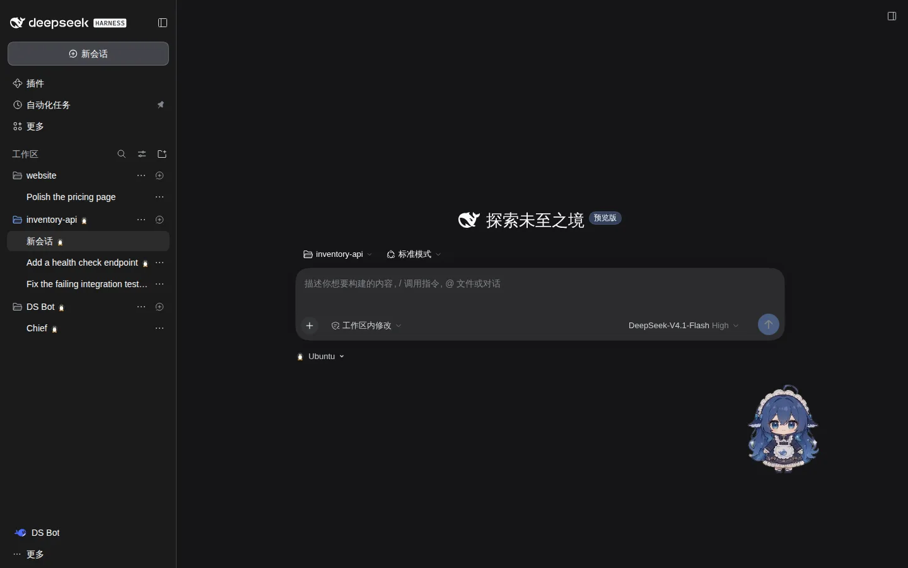
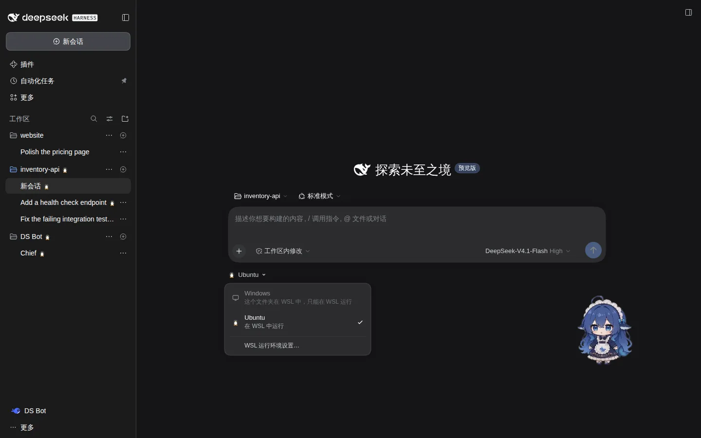
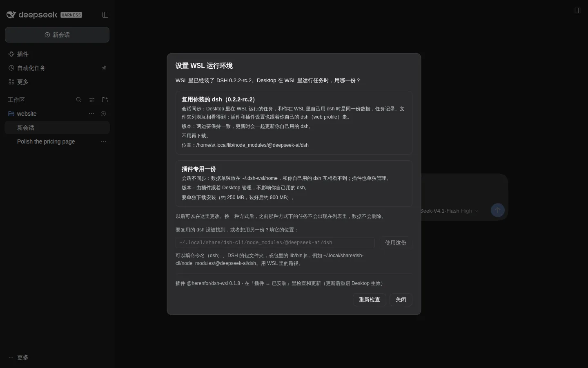
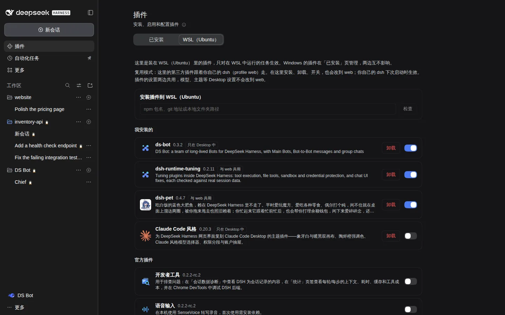
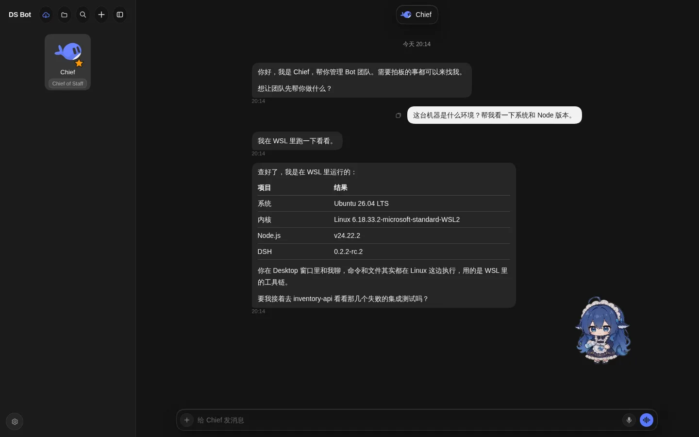

<div align="center">


# dsh-wsl

**让 Windows 版 DeepSeek Harness 把任务放进 WSL 运行，界面还是 Desktop 的窗口**

[](https://www.npmjs.com/package/@herenfor/dsh-wsl)   [](LICENSE)

[English](README.md) · 中文

</div>



<sub>截图来自测试环境，仅作展示。图中的第三方插件见文末「截图说明」。</sub>

## 亮点

- **按文件夹选运行位置**：在输入框下方切换 Windows 或 WSL；WSL 里的文件夹自动在 WSL 运行。
- **一个窗口管两边**：侧栏、定时任务、设置里的选项都同时列出 Windows 和 WSL 的。
- **Linux 插件照常用**：装在 WSL 里的插件，包括改界面的，在 Desktop 窗口里也能用；插件页有单独的 WSL 标签页。
- **凭据不进 WSL**：WSL 任务用的模型凭据向 Desktop 取，不写进 WSL 的磁盘。
- **不改官方代码**：只用插件和外部组件实现，跟着 Desktop 一起启动和退出。

## 截图

<table>
<tr>
<td width="50%"><br><sub>输入框下方选运行位置</sub></td>
<td width="50%"><br><sub>首次设置：复用你装的 dsh，或用插件专用的一份</sub></td>
</tr>
<tr>
<td width="50%"><br><sub>插件页的 WSL 标签页</sub></td>
<td width="50%"><br><sub>装在 WSL 里的 DS Bot，专属界面在 Desktop 窗口里照常使用</sub></td>
</tr>
</table>

## 快速开始

**安装位置：只在 Windows Desktop 安装 `@herenfor/dsh-wsl`。WSL 配套组件 `dsh-wsl-agent` 由插件自动部署，无需在 WSL 再装一次桥接插件。**

1. Desktop → 插件 → 添加插件 → 安装第三方插件，填 `@herenfor/dsh-wsl`，然后安装。
2. 完全退出 Desktop（包括系统托盘里的），等 5 秒以上再打开。
3. 在新任务页把输入框下方的运行位置切到 WSL，按「设置 WSL 运行环境」窗口的提示完成。

复用模式会自动识别 PATH 和常见独立安装目录中的 DSH；一般无需填写入口。手动入口在「高级」中设置。已有 pnpm 版本路径会在对应稳定包入口有效时自动修复；升级后重新检查即可识别新版本。

**rc.3 实测（2026-11-14）**：Windows Desktop 与 WSL 均为 DSH `0.2.2-rc.3`，使用 `0.1.12-dev.1` 候选包确认了入口自动识别、旧 pnpm 路径持久化迁移、rc.3 Host / daemon 启动，以及首次重启后的连接和任务镜像。UI 仅核对代码与状态，迁移日志未直接观察；这次验收未覆盖全部插件组合或第二次重启。

**0.1.13 本机检查（2026-11-14）**：DSH `0.2.2-rc.3` 真实管理器与隔离双 Host，覆盖误装拒绝、卸载恢复、会话保留及重装连接；中文提示经截图检查。Desktop 侧由 Linux 私有副本模拟，尚未验证原生 Electron 窗口。最近使用端记录为插件 `0.1.12`、Desktop / WSL 均为 rc.3：重启后桥接及优化插件正常，`web` 未启动，未在线新建会话。

需要 Windows 10 或 11 上的 DSH Desktop 0.2.x 和 WSL 2。目前在 DSH 0.2.2-rc.1、0.2.2-rc.2 和 0.2.2-rc.3 上测试过。功能细节、其他安装方式、更新、卸载、排错和已知限制，见[插件说明](experiments/mirror/mirror/README.zh.md)。

---

## 工作方式

```
Windows                                    WSL
Desktop（DSH Host + 页面）                 DSH Host（profile desktop-wsl）
  └ 插件 @herenfor/dsh-wsl                    └ 插件 dsh-wsl-agent
      ├ 按任务分流：WSL 任务的请求转给 WSL       ├ 上报 WSL 的界面模块、路由和插件
      ├ 合并两边的侧栏、界面模块和设置          └ 凭据代理：用的时候向 Desktop 要
      └ 一条 wsl.exe 连接  ◄──────────────►  常驻进程（daemon），Desktop 关闭 5 秒后退出
```

- 传输：`wsl.exe` 的标准输入输出上跑一条多路复用连接，WSL 端是常驻进程，和 Claude Code 桌面版的 WSL 模式同一种思路。
- 会话 ID：WSL 的会话和文件夹在页面上带 `wsl:` 前缀，请求转发时按字段和按值改写。
- 凭据：不复制到 WSL，WSL 端换上凭据代理，用的时候向 Desktop 要。
- 设置：单向同步到 WSL。指向某个清单条目的设置（默认预设、搜索服务、默认模型等）记下用户的选择，每边只存它自己有的值，没有就用那边的默认；MCP、沙箱这类本机专属的设置不同步。规则和取舍见 [docs/cross-host-rules.md](docs/cross-host-rules.md)。
- 跨两边的列表：定时任务、预设、模型等列表合并两边，单条操作按 ID 前缀送回所在的一边。

## 仓库结构

| 路径 | 内容 |
|---|---|
| `experiments/mirror/mirror/` | Desktop 端插件，也就是发布到 npm 的包：分流、合并、设置窗口、WSL 插件页、页面代码 `client.js` |
| `experiments/mirror/agent/` | WSL 端插件 `dsh-wsl-agent`，随 Desktop 端插件一起带进 WSL |
| `experiments/transport/` | `wsl.exe` 连接：多路复用（`mux.mjs`）、Desktop 端（`client.mjs`）、WSL 常驻进程（`daemon.mjs`） |
| `experiments/mirror/tests/` | 单元测试 |
| `scripts/release.sh` | 发布一个版本（见下） |
| `scripts/assemble.sh` | 把 transport 和 agent 拷进插件包 |
| `.github/workflows/publish.yml` | 推送版本标签时发布到 npm |
| `scripts/sync-windows.sh` | 开发用：组装后再拷到 Windows 测试目录 |
| `dev/` | 开发用测试环境：Linux 上的 `dsh web` 冒充 Desktop、假 `wsl.exe`、截图工具，见 [dev/README.md](dev/README.md) |
| `docs/` | 设计和实验记录（中文） |
| `CLAUDE.md` | 给接手的 agent：状态、代码入口、规则 |

## 开发

```bash
node --test experiments/mirror/tests/*.test.mjs
```

### 发布

```bash
scripts/release.sh 0.1.1 --dry-run   # 跑测试、组装、检查包内容，不做任何改动
scripts/release.sh 0.1.1             # 再改版本号、提交、打标签 v0.1.1 并推送
```

推上去的标签会触发 `.github/workflows/publish.yml`：跑测试，检查标签和版本号一致、包里带的是最新的 WSL 端文件，然后用 npm 的 Trusted Publishing 发布（GitHub 上不存 npm 密钥）。带预发布后缀的版本（如 `0.2.0-beta.1`）发布到 npm 标签 `next`。已安装的插件由用户在插件页里更新，不会在后台自动更新。

自动发布要先在 npmjs.com 上 `@herenfor/dsh-wsl` 的设置里添加 Trusted Publisher（GitHub Actions，仓库 `herenfor/dsh-wsl`，工作流 `publish.yml`）。在那之前，或者想在自己电脑上发布时，`npm login` 后运行 `scripts/release.sh <版本> --local`：它先发布，等 npm 上能查到这个版本（npm 要求两步验证确认时，到 npmjs.com 上确认），再提交、打标签并推送。失败时什么都不会改，直接重新运行即可。

`scripts/assemble.sh` 把 `experiments/transport` 和 `experiments/mirror/agent` 的最新文件拷进插件包，发布脚本会自动运行它。`scripts/sync-windows.sh` 是开发用的：它还会把插件包拷到你指定的、某个 Desktop 用 link 安装的 Windows 测试目录。端到端测试一般用 `dev/` 的测试环境就够了。

## 文档

- [docs/bridge-plan.md](docs/bridge-plan.md)：桥接方案（传输、部署、按会话分流）。
- [docs/session-routing.md](docs/session-routing.md)：按会话分流，每个任务在 Windows 或 WSL 中运行，侧栏列出两边。
- [docs/plugin-management.md](docs/plugin-management.md)：插件管理方式和界面镜像。
- [docs/panel.md](docs/panel.md)：插件页（现在是 Windows 和 WSL 分开的两个标签页）。
- [docs/credentials.md](docs/credentials.md)：WSL 会话怎么使用 Desktop 的凭据。
- [docs/deployment.md](docs/deployment.md)：首次设置、版本规则、插件更新、界面语言。
- [docs/cross-host-scan.md](docs/cross-host-scan.md) 和 [docs/cross-host-rules.md](docs/cross-host-rules.md)：两边差异的扫描，以及处理这些差异的规则（对照 VS Code Remote 和 Claude Code）。

## 截图说明

截图来自测试环境，仅作展示。图中的第三方插件：桌宠 [dsh-pet](https://github.com/PC2005-cloud/dsh-pet)（PC2005-cloud，代码 MIT，形象素材禁止商用）、[DS Bot](https://github.com/Fei2411/DS-Bot)（Fei2411，Apache-2.0）、[Claude Code 风格](https://github.com/Nwflower/dsh-claude-style)（Nwflower，MIT）、[dsh-runtime-tuning](https://github.com/herenfor/dsh-runtime-tuning)（MIT）。名称和形象归各自作者所有。DS Bot 截图里的回复由测试用的本地模拟模型生成，表格中的系统信息是命令在 WSL 里实际运行的输出。

## 许可证

MIT，见 [LICENSE](LICENSE)。`experiments/mirror/mirror/ids.mjs` 中的 ID 字段表改编自 [dsh-ssh-workspaces](https://github.com/czp0312/dsh-ssh-workspace)（MIT），其版权声明随插件包一起分发（`experiments/mirror/mirror/LICENSE`）。
