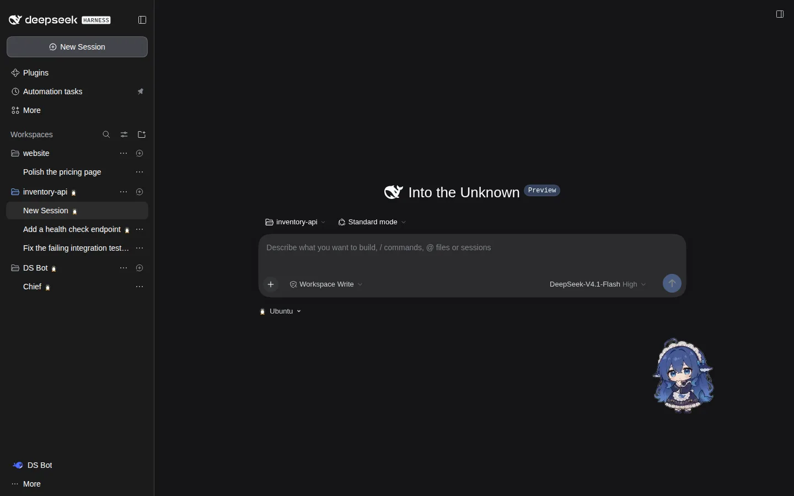
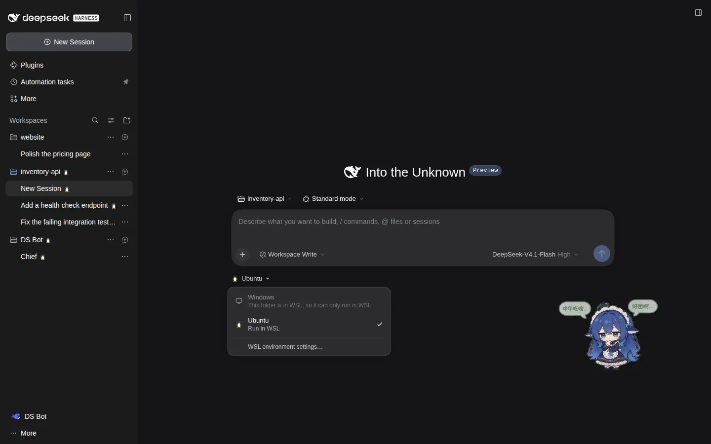
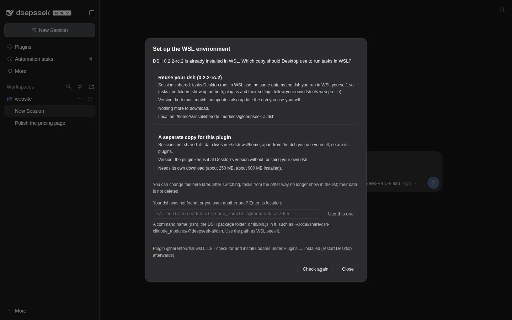
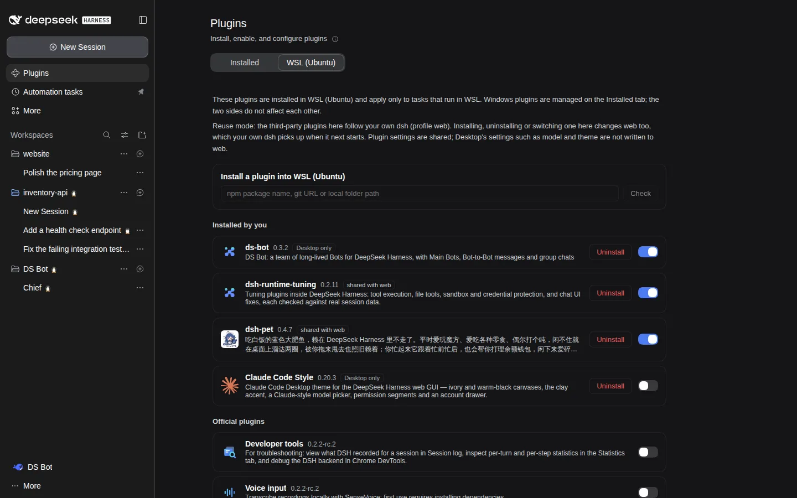
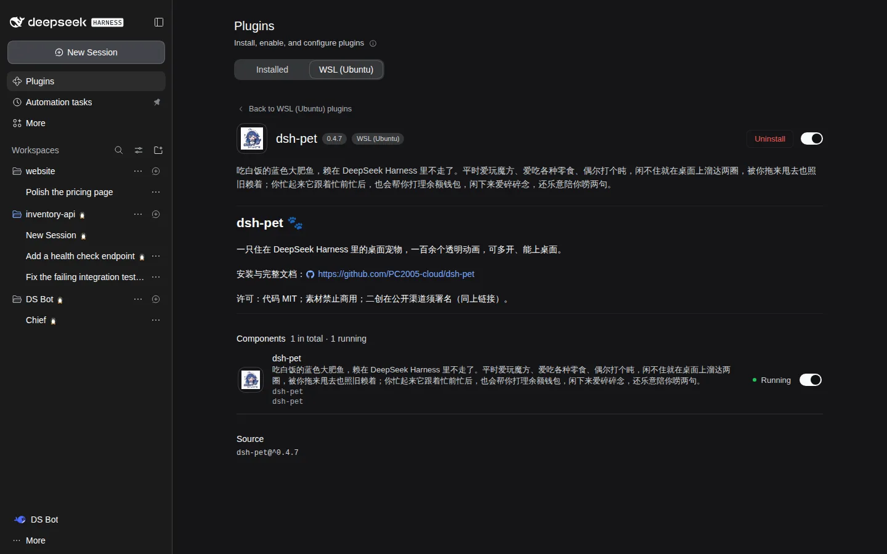
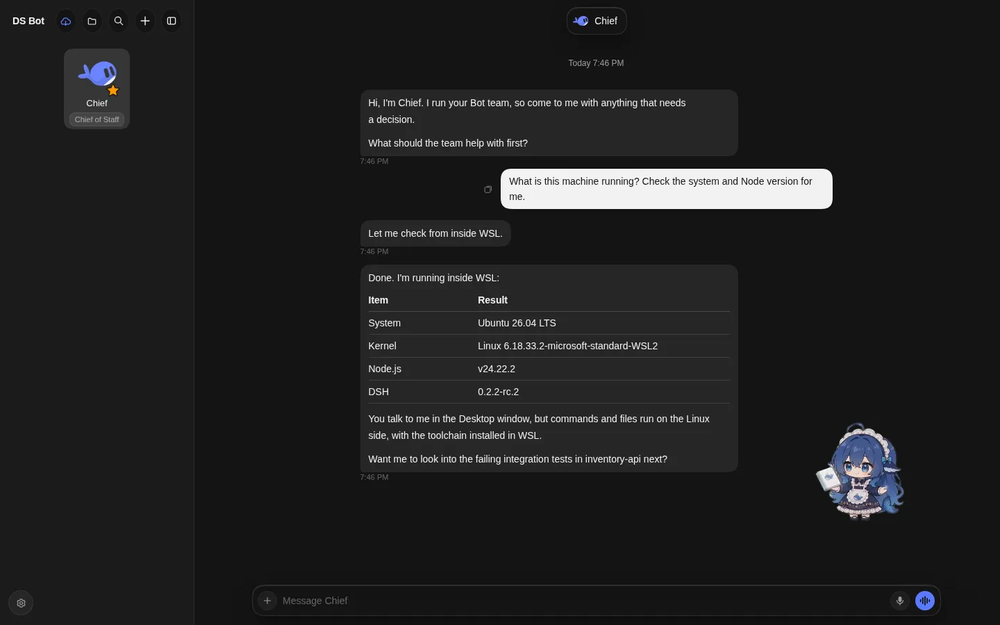

# DSH WSL run mode

English | [中文](README.zh.md)

Lets DeepSeek Harness Desktop on Windows run tasks in WSL. For a task set to WSL, the agent, its commands, file access and plugins all run in a DSH inside WSL, while you keep using the Desktop window.

> Beta. Tested with DSH 0.2.2-rc.1 and 0.2.2-rc.2 so far. Please report problems on [GitHub](https://github.com/herenfor/dsh-wsl/issues).

Screenshots from a test environment, for illustration only. Third-party plugins shown: the desktop pet [dsh-pet](https://github.com/PC2005-cloud/dsh-pet) (PC2005-cloud; code MIT, character art not for commercial use), [DS Bot](https://github.com/Fei2411/DS-Bot) (Fei2411, Apache-2.0), [Claude Code Style](https://github.com/Nwflower/dsh-claude-style) (Nwflower, MIT) and [dsh-runtime-tuning](https://github.com/herenfor/dsh-runtime-tuning) (MIT). Names and artwork belong to their authors. In the DS Bot screenshot, the replies come from a local stand-in model used for testing; the system details in the table are the real output of the command run in WSL.

## What it does

- **Choose where each task runs**: on the new-task page, pick "Windows" or "WSL (distribution)" under the input box. Folders inside WSL (`\\wsl.localhost\…`) always run in WSL.
- **Add WSL folders**: when adding a folder, choose a Windows folder or a WSL folder. A WSL folder is picked by browsing the Linux file system right in Desktop.
- **Both sides in one list**: the sidebar lists the folders and tasks of Windows and WSL together, with a small penguin on WSL ones. Approvals, questions, subagents and live titles work as in any task.
- **WSL plugins on their own tab**: the Plugins page gets a "WSL (distribution)" tab to install, enable, disable and uninstall plugins in WSL, with a page per plugin showing its description and the state of each component. The official Installed tab still covers Windows only; the two sides do not affect each other. Plugins installed only in WSL, including ones that change the interface, work in the Desktop window too.
- **Desktop's model credentials**: when a WSL task calls a model, it asks Desktop for the credentials; API keys and sign-ins are never written to the WSL disk. An API key you entered in WSL yourself takes precedence.
- **Desktop's settings win**: settings you can change in Desktop (model, theme, language and so on) are copied one way into WSL; settings only WSL plugins have stay in WSL.
- **Starts and stops with Desktop**: the WSL side starts when Desktop opens and exits about 5 seconds after Desktop closes.
- **Follows DSH's language**: Chinese and English for now; other languages show English.

## Requirements

- DSH Desktop 0.2.x on Windows 10 or 11.
- WSL 2 with a Linux distribution: Ubuntu, Debian or whichever you have.
- A DSH in WSL whose version matches Desktop in its first two parts (for example both 0.2.x). Without one, the plugin lists the install commands; it can run them for you or hand them to the Windows DSH (step 3 below).

## Install

1. Desktop → Plugins → Add plugin → Install a third-party plugin, enter `@herenfor/dsh-wsl` and install.
2. Quit Desktop completely (if it keeps running in the system tray, quit it there too), wait at least 5 seconds, then open it again. Until then the plugin does not start working, and the bottom of the sidebar says to restart Desktop.
3. On the new-task page, switch the run location under the input box to WSL. The first time, "Set up the WSL environment" opens; choose one way:
   - **Reuse your dsh**: offered when WSL already has dsh. Desktop shares data with the dsh you use in WSL yourself, so tasks show up on both; plugins follow your own dsh too (see "Installing plugins in WSL" below); updates update both. The plugin looks for `dsh` on your PATH (including a login shell's), in `~/.local/bin`, `/usr/local/bin`, `/usr/bin`, and in the global folders of nvm, fnm, pnpm, bun and `~/.npm-global`. If yours is somewhere else (installed into a project folder, or started by a script of your own), enter its location in the setup window: the command, the `@deepseek-ai/dsh` package folder or its `lib/bin.js`.
   - **A separate copy for this plugin**: installed in `~/.dsh-wsl/dsh` with its data in `~/.dsh-wsl/home`, leaving your own dsh alone. About 250 MB to download, about 900 MB installed.

   If Node.js or DSH is missing, the window lists the commands to run, and under "Where setup looked" which places were checked. Node.js must be as new as your DSH asks for (24.9 or newer for DSH 0.2); one installed with nvm, fnm, asdf, mise or Volta is found too, so with nvm you can also run `nvm install 24` and click "Check again". Click "Install automatically", click "Let DSH install it" to have the Windows DSH run them, or run them yourself in a WSL terminal. The plugin never downloads anything in the background on its own.

   

4. Once connected, the loading note at the bottom of the sidebar goes away and the WSL folders and tasks appear in the sidebar.

### Other ways to install

The install box in step 1 also takes these, but a plugin installed this way cannot be updated from the Plugins page:

- From GitHub: `github:herenfor/dsh-wsl#path:/experiments/mirror/mirror`, or for a given version `github:herenfor/dsh-wsl#v0.1.0&path:/experiments/mirror/mirror`.
- From a local folder: download the repository to Windows and enter the full path of its `experiments/mirror/mirror` folder.

## Installing plugins in WSL

Desktop runs its WSL tasks in a profile of its own in WSL, `desktop-wsl`. Where its plugins come from depends on the run mode:

- **Reuse your dsh**: plugins follow the `web` profile of your own dsh. Each time Desktop starts the WSL side, the plugins installed in `web`, whether they are on, and their settings are carried over; installing, uninstalling or switching a plugin in the tab below changes `web` too (your own dsh picks it up when it next starts); plugin settings changed in Desktop are written back to `web` at the next start, and when both sides changed one, `web` wins. Desktop's own settings (model, theme, language and so on) are never written to `web`. Plugins installed only in `desktop-wsl` before stay as they are, marked "Desktop only" in the tab. To follow another profile, add `"pluginProfile": "<name>"` to `%USERPROFILE%\.dsh-wsl\config.json`.
- **A separate copy for this plugin**: its plugins are its own, starting with the official ones.

Install here:

Plugins → "WSL (distribution)" → enter an npm package name, git URL or local folder path in the install box → Check → Install. Windows paths are turned into WSL paths. When it says a restart is needed, quit Desktop completely, wait at least 5 seconds and open it again.

## Updates

- The plugin itself never updates in the background, which could cut off WSL tasks that are running. Check for and install updates under Plugins → Installed → WSL run mode, at a moment when no WSL task is running, then quit Desktop completely and open it again; until then the sidebar asks for the restart. The bottom of the setup window shows the installed version.
- The DSH in WSL follows Desktop's version. After Desktop updates, the setup window offers to update the WSL side. A dsh you reuse that is not an npm global install (in a project folder, or installed with pnpm) is not updated by the plugin, which would put a second copy beside it: update it your own way.

## Uninstall

1. Desktop → Plugins → Installed → uninstall "WSL run mode", then restart Desktop.
2. Remove what is left in WSL by hand:
   - `~/.dsh-wsl`: connection files, logs, and in the separate-copy mode its DSH and data.
   - In the reuse mode also `~/.dsh/profiles/desktop-wsl`, the profile the plugin created. Task data lives in `~/.dsh`, shared with your own dsh: **do not delete all of `~/.dsh`**.

## When something goes wrong

- When the bottom of the sidebar says the WSL side failed to start, click it to see the error.
- When your dsh or Node.js is not found, the setup window lists where it looked. The full output of the last check is in `%USERPROFILE%\.dsh-wsl\setup-probe.log` on Windows.
- If you chose to reuse your dsh and it is later not found (moved, removed), the WSL side stays off and the setup window asks for its new location; it does not switch to the plugin's own copy by itself.
- The WSL side's log is `~/.dsh-wsl/run/desktop-wsl/daemon.log`. When the WSL side fails before it can write that log, the error is in `%USERPROFILE%\.dsh-wsl\bridge.log` on Windows.
- Feedback: <https://github.com/herenfor/dsh-wsl/issues>

## Known limitations

- Tested only with DSH 0.2.2-rc.1 and 0.2.2-rc.2. Desktop and the DSH in WSL must match in the first two parts of their versions.
- In the separate-copy mode, WSL tasks are not shared with your own dsh, and tasks cannot be moved between the two ways yet.
- Reusing your dsh runs its package directly with Node, with its data in `~/.dsh`. It does not go through launch scripts or wrappers of your own: environment variables, ports or a `DSH_HOME` set there are not applied.
- When a WSL plugin's patch changes the configuration of an official component (rather than switching it off), that change does not apply in the Desktop window.
- The interface of WSL plugins loads into the whole Desktop window, not only into WSL tasks.
- Closing Desktop stops the WSL side as well; WSL tasks do not keep running in the background.

## License

MIT. The session ID field table is adapted from [dsh-ssh-workspaces](https://github.com/czp0312/dsh-ssh-workspace) (MIT); see `LICENSE` for its notice.
