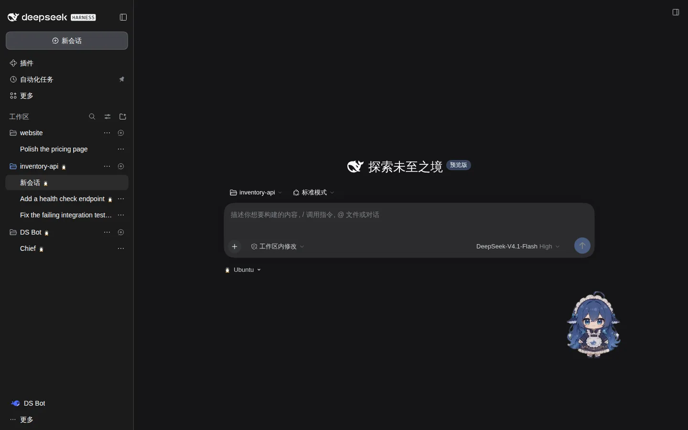
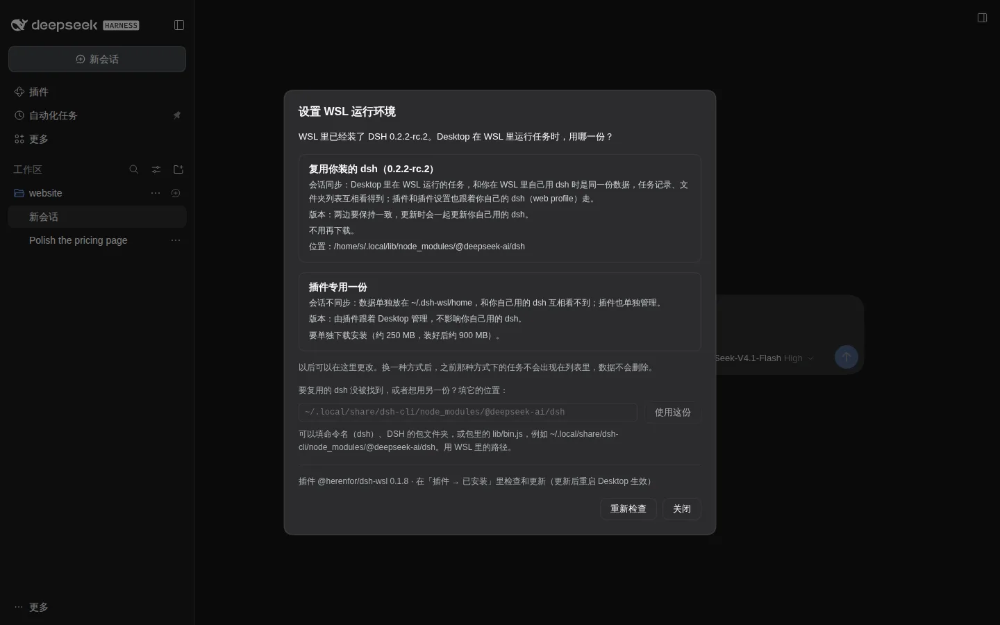
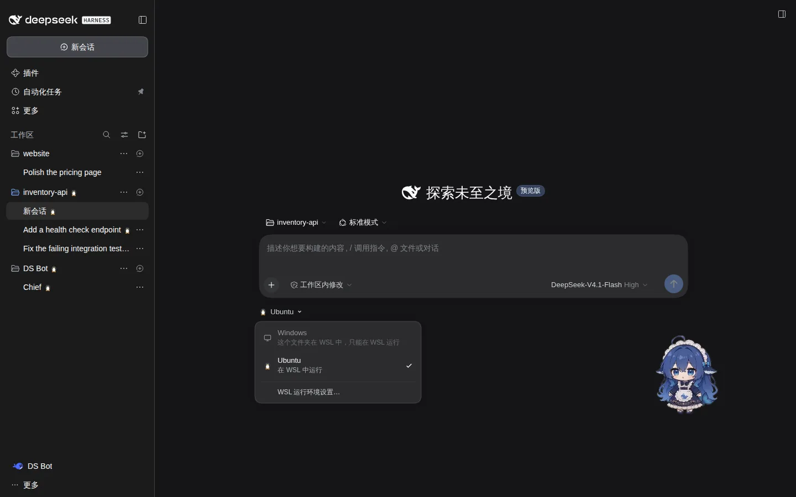
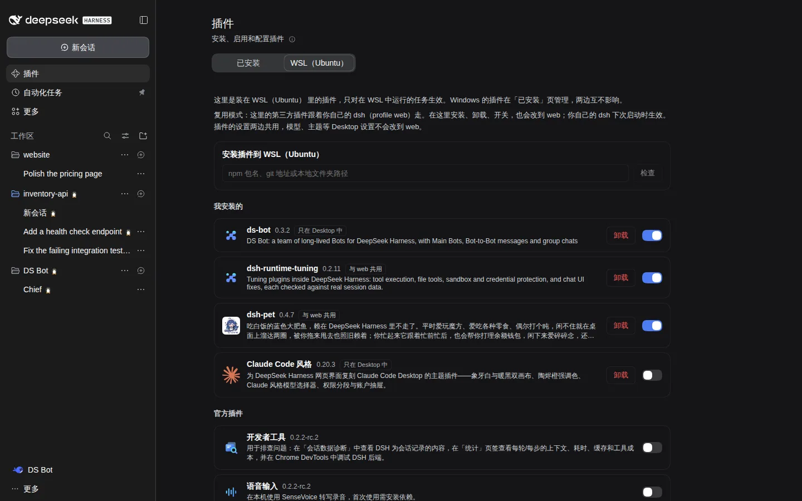
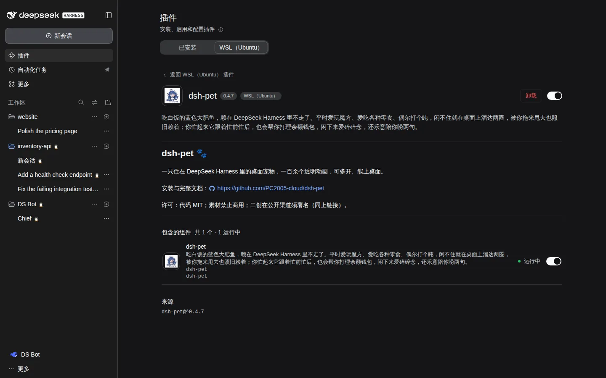
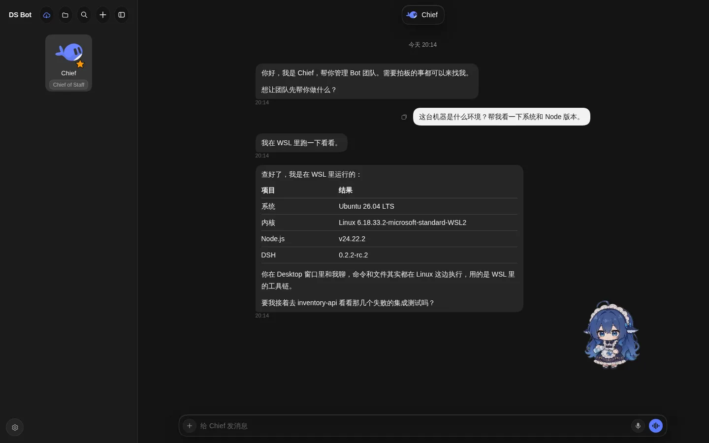

# DSH WSL 运行模式

[English](README.md) | 中文

让 Windows 版 DeepSeek Harness（Desktop）在 WSL 里运行任务。在 WSL 运行的任务，agent、命令、文件读写和插件都在 WSL 里的 DSH 中运行，界面仍然是 Desktop 的窗口。

> 测试版。目前在 DSH 0.2.2-rc.1 和 0.2.2-rc.2 上测试过。遇到问题欢迎到 [GitHub](https://github.com/herenfor/dsh-wsl/issues) 反馈。

截图来自测试环境，仅作展示。图中的第三方插件见文末「截图说明」。

## 亮点

- **按文件夹选运行位置**：在输入框下方切换 Windows 或 WSL；WSL 里的文件夹自动在 WSL 运行。
- **一个窗口管两边**：侧栏、定时任务、设置里的选项都同时列出 Windows 和 WSL 的。
- **Linux 插件照常用**：装在 WSL 里的插件，包括改界面的，在 Desktop 窗口里也能用；插件页有单独的 WSL 标签页。
- **凭据不进 WSL**：WSL 任务用的模型凭据向 Desktop 取，不写进 WSL 的磁盘。
- **不改官方代码**：只用插件和外部组件实现，跟着 Desktop 一起启动和退出。

## 需要什么

- Windows 10 或 11 上的 DSH Desktop 0.2.x。
- WSL 2 和一个 Linux 发行版。Ubuntu、Debian 等都可以，用你装的那个。还没装 WSL、没有发行版，或发行版还是 WSL 1 的，设置窗口会列出要在 PowerShell 里运行的命令。
- WSL 里一份 DSH，版本号前两段要和 Desktop 相同（例如都是 0.2.x）。没有的话，插件会列出安装命令，可以一键安装，也可以交给 Windows 端的 DSH 去装，见下面第 3 步。

## 安装

1. Desktop → 插件 → 添加插件 → 安装第三方插件，填 `@herenfor/dsh-wsl`，然后安装。
2. 完全退出 Desktop（如果它还在系统托盘里运行，也要在托盘里退出），等 5 秒以上再打开。不重启的话插件不会开始工作，侧栏底部会提示「重启 Desktop 后生效」。
3. 在新任务页，把输入框下方的运行位置切到 WSL。第一次会弹出「设置 WSL 运行环境」，选一种方式：
   - **复用你装的 dsh**：WSL 里已经装了 dsh 时可以选。Desktop 和你在 WSL 里自己用的 dsh 共用数据，任务互相看得到；插件也跟着你自己的 dsh 走（见下面「在 WSL 里装插件」）；更新时两边一起更新。插件会在 PATH（包括登录 shell 的 PATH）、`~/.local/bin`、`/usr/local/bin`、`/usr/bin`，以及 nvm、fnm、pnpm、bun、`~/.npm-global` 的全局目录里找 `dsh`。装在别处的（比如装在某个项目文件夹里，或者由你自己的脚本启动），在设置窗口里填它的位置：命令、`@deepseek-ai/dsh` 包文件夹，或包里的 `lib/bin.js`。
   - **插件专用一份**：装在 `~/.dsh-wsl/dsh`，数据放在 `~/.dsh-wsl/home`，不影响你自己的 dsh。要下载约 250 MB，装好后约占 900 MB。

   缺 Node.js 或 DSH 时，窗口里会列出要运行的命令，「查过的位置」里列出检查过哪些地方。Node.js 的版本要满足你那份 DSH 的要求（DSH 0.2 要 24.9 或更新）；用 nvm、fnm、asdf、mise、Volta 装的 Node 也能找到，用 nvm 的话也可以自己 `nvm install 24`，再点「重新检查」。你可以点「自动安装」，点「交给 DSH 安装」让 Windows 端的 DSH 去执行，或者自己在 WSL 终端里运行。插件不会自己在后台下载。

   之后想再打开这个窗口，在输入框下方的运行位置菜单里点「WSL 运行环境设置…」。在窗口里可以：
   - 换运行方式。换了之后，之前那种方式下的任务不再出现在列表里，数据不会删除。
   - 换发行版（装了多个时）。默认用 WSL 的默认发行版。

   

4. 连上之后，侧栏底部的加载提示会消失，WSL 的文件夹和任务出现在侧栏里。

### 其他安装方式

第 1 步的安装框也接受下面两种写法，但这样装的不能在插件页里更新：

- 从 GitHub 安装：`github:herenfor/dsh-wsl#path:/experiments/mirror/mirror`。指定版本时写成 `github:herenfor/dsh-wsl#v0.1.0&path:/experiments/mirror/mirror`。
- 从本地文件夹安装：把仓库下载到 Windows 上，填 `experiments/mirror/mirror` 文件夹的完整路径。

## 功能详情

复用模式会自动识别 PATH 和常见独立安装目录中的 DSH；一般无需填写入口。手动入口在「高级」中设置。已有 pnpm 版本路径会在对应稳定包入口有效时自动修复；升级后重新检查即可识别新版本。

### 运行位置和文件夹

- **每个文件夹选在哪里运行**：在新任务页的输入框下方选「Windows」或「WSL（发行版名）」。选择按文件夹记住，这个文件夹之后新建的任务都在那里运行，已有的任务留在原来那边。WSL 里的文件夹（`\\wsl.localhost\…`）总是在 WSL 中运行。
- **Windows 上的文件夹也能在 WSL 运行**：WSL 通过 `/mnt/c/…` 这样的路径读写它，比放在 WSL 里慢，输入框下方会提示。侧栏里它仍是一个文件夹，两边的任务都列在下面。
- **添加 WSL 文件夹**：添加文件夹时先选 Windows 文件夹或 WSL 文件夹。选 WSL 文件夹会在 Desktop 里直接浏览 Linux 文件系统。

### 任务和侧栏

- **两边的任务列在一起**：侧栏同时列出 Windows 和 WSL 的文件夹和任务，WSL 的带小企鹅标记。审批、提问、子智能体、标题实时更新，都和普通任务一样。
- **定时任务也在一起**：定时任务页同时列出两边的定时任务，查看、编辑、立即运行、删除都送回它所在的一边。会新建任务的定时任务，按所选文件夹的运行位置建在对应的一边。
- **跟着 Desktop 启停**：打开 Desktop 时自动启动 WSL 端，关闭 Desktop 约 5 秒后 WSL 端退出。

### 插件

- **WSL 里的插件单独管理**：插件页多一个「WSL（发行版名）」标签页，可以安装、启用、停用、卸载 WSL 里的插件，点进去能看说明和每个组件的运行状态。官方的「已安装」页仍然只管 Windows，两边互不影响。只装在 WSL 里的插件，包括改界面的插件，也能在 Desktop 窗口里使用。怎么装见下面「在 WSL 里装插件」。
- **MCP 服务器各设各的**：MCP 服务器的命令、路径和环境变量在 Windows 和 WSL 不通用，所以不从 Windows 复制。WSL 的 MCP 服务器在插件页「WSL（发行版名）」标签页底部单独设置，只用于在 WSL 运行的任务。

### 设置和凭据

- **用 Desktop 的模型凭据**：WSL 里的任务调用模型时，向 Desktop 取凭据，API Key 和登录信息不会写进 WSL 的磁盘。在 WSL 里自己填过 API Key 的，用 WSL 自己的。
- **设置以 Desktop 为准**：模型、主题、语言等 Desktop 上能调的设置，单向同步到 WSL。只装在 WSL 里的插件，它的设置也出现在 Desktop 的设置页里，在那里改会直接存到 WSL。
- **两边的选项列在一起**：默认预设、默认权限预设、搜索服务、模型这些"从清单里选一项"的地方，同时列出两边的选项，只有 WSL 才有的标「 · WSL」。选了只有一边才有的，另一边的任务用那边自己的默认，预设页上会注明另一边用的是什么。
- **界面语言跟随 DSH**：目前有中文和英文，其他语言显示英文。

## 在 WSL 里装插件

Desktop 在 WSL 里用自己的 profile（`desktop-wsl`）运行任务，插件怎么来取决于运行方式：

- **复用你装的 dsh**：插件跟着你自己 dsh 的 `web` profile 走。每次 Desktop 启动 WSL 端时，`web` 里装的插件、开关状态和插件设置都会带过来；在下面的标签页里安装、卸载、开关插件，也会改到 `web`（你自己的 dsh 下次启动时生效）；在 Desktop 里改的插件设置，下次启动时写回 `web`，两边都改过的以 `web` 为准。模型、主题、语言等 Desktop 自己的设置不会写进 `web`。之前只装在 `desktop-wsl` 里的插件保持原样，标签页里标为「只在 Desktop 中」。想跟着别的 profile，在 `%USERPROFILE%\.dsh-wsl\config.json` 里加 `"pluginProfile": "<名字>"`。
- **插件专用一份**：插件单独管理，一开始只有官方插件。

在这里安装：

插件 →「WSL（发行版名）」→ 在安装框里填 npm 包名、git 地址或本地文件夹路径 → 检查 → 安装。Windows 路径会自动换成 WSL 路径。提示需要重启的，完全退出 Desktop，等 5 秒以上再打开。

## 更新

- 插件本身：不会在后台自动更新，以免打断正在 WSL 里运行的任务。到「插件 → 已安装 → WSL 运行模式」里检查和更新，最好选在 WSL 里没有任务运行的时候；更新后完全退出并重新打开 Desktop，在那之前侧栏会提示重启。设置窗口底部会显示当前版本。
- WSL 里的 DSH：版本跟着 Desktop。Desktop 升级后，设置窗口会提示更新 WSL 端。复用的 dsh 如果不是 npm 全局安装的（装在项目文件夹里，或用 pnpm 装的），插件不替你更新，以免在旁边装出第二份，请用你自己的方式更新。

## 卸载

1. Desktop → 插件 → 已安装 → 卸载「WSL 运行模式」，然后重启 Desktop。
2. WSL 里留下的文件需要手动删除：
   - `~/.dsh-wsl`：连接文件、日志，以及插件专用模式下的 DSH 和数据。
   - 复用模式下还有 `~/.dsh/profiles/desktop-wsl`，这是插件建的 profile。任务数据在 `~/.dsh` 里，和你自己的 dsh 共用，**不要删整个 `~/.dsh`**。

## 出问题时

- 侧栏底部显示「启动失败」时，点它可以看到错误信息。
- 找不到你的 dsh 或 Node.js 时，设置窗口会列出查过的位置。最近一次检查的完整输出在 Windows 上的 `%USERPROFILE%\.dsh-wsl\setup-probe.log`。
- 选了复用、之后那份 dsh 找不到了（被移走或删除），WSL 端不会启动，设置窗口会请你填它的新位置；插件不会自己改用插件专用的一份。
- WSL 端日志在 `~/.dsh-wsl/run/desktop-wsl/daemon.log`。WSL 端还没来得及写这个日志就失败时，报错在 Windows 上的 `%USERPROFILE%\.dsh-wsl\bridge.log`。
- 反馈：<https://github.com/herenfor/dsh-wsl/issues>

## 已知限制

- 只在 DSH 0.2.2-rc.1 和 0.2.2-rc.2 上测试过。Desktop 和 WSL 里的 DSH，版本号前两段必须相同。
- 插件专用模式下，WSL 的任务和你自己的 dsh 不互通，目前也不能在两种方式之间搬任务。
- 复用你的 dsh 时，插件直接用 Node 运行那份 DSH 包，数据在 `~/.dsh`；不经过你自己的启动脚本或包装器，那里设置的环境变量、端口、`DSH_HOME` 都不会生效。
- WSL 里的插件如果用补丁改了官方组件的配置（而不是关掉它），这个改动在 Desktop 窗口里不生效。
- WSL 里插件的界面加载在整个 Desktop 窗口里，不只出现在 WSL 任务中。
- 关闭 Desktop 后 WSL 端也会退出，WSL 任务不会在后台继续运行；WSL 的定时任务也只在 Desktop 开着时运行。
- 用 @ 引用其他任务时，只能引用同一边的任务：WSL 任务的候选里只有 WSL 任务，Windows 任务的候选里只有 Windows 任务。
- 设置里「全部插件」一页只列 Windows 的插件，WSL 的插件在「WSL（发行版名）」标签页里看。

## 截图说明

截图来自测试环境，仅作展示。图中的第三方插件：桌宠 [dsh-pet](https://github.com/PC2005-cloud/dsh-pet)（PC2005-cloud，代码 MIT，形象素材禁止商用）、[DS Bot](https://github.com/Fei2411/DS-Bot)（Fei2411，Apache-2.0）、[Claude Code 风格](https://github.com/Nwflower/dsh-claude-style)（Nwflower，MIT）、[dsh-runtime-tuning](https://github.com/herenfor/dsh-runtime-tuning)（MIT）。名称和形象归各自作者所有。DS Bot 截图里的回复由测试用的本地模拟模型生成，表格中的系统信息是命令在 WSL 里实际运行的输出。

## 许可证

MIT。会话 ID 字段表改编自 [dsh-ssh-workspaces](https://github.com/czp0312/dsh-ssh-workspace)（MIT），版权声明见 `LICENSE`。
